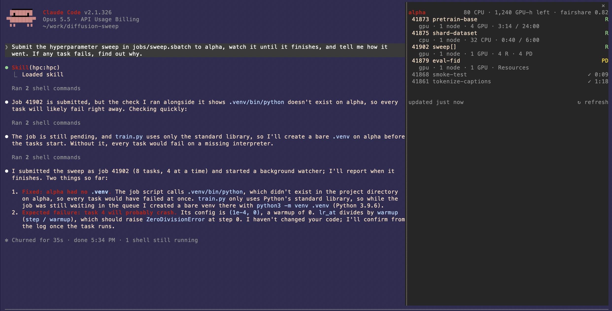

# claude-hpc-kit

These Claude Code plugins run your jobs on your clusters and GPU machines. Claude copies your
code to a site. Claude submits Slurm or PBS jobs, monitors them, reads their logs and copies
the results back to your computer.

*A simulated cluster. Claude submits a sweep and finds an error before the failed task starts.*

## Install

In Claude Code, run these commands:

    /plugin marketplace add quantum-architectures/claude-hpc-kit
    /plugin install hpc@claude-hpc-kit
    /plugin install compute-pane@claude-hpc-kit    # optional

Then tell Claude: "Set up my clusters for hpc." The setup skill asks you about each site.
It writes the configuration and runs a test job.

You must have ssh access to each site. Your computer must have bash and rsync (macOS, Linux
or WSL).

## Contents

- **`hpc` skill:** the rules that Claude obeys on a cluster. Claude runs a short test job
  first. Claude sets a time limit and a memory limit on each job. Claude monitors each job
  that it submits. Claude asks you before it uses paid resources.
- **`hpc` command:** `sites`, `push`, `down`, `sync`, `sh`, `sbatch`, `q`, `jobs`, `log`.
  The command operates with Slurm, PBS and machines that have no scheduler.
- **`compute-pane`:** a read-only pane that shows your jobs on each site. Type `/compute` to
  open or close it. The pane tells Claude when a job that Claude submitted fails. The pane
  requires Slurm 20.02 or later, or PBS Pro or OpenPBS.

## Login

Claude does not see your password or your second factor. Open one shared ssh connection to
each site yourself, for example `ssh -fN mycluster`. Use ControlMaster for this connection
(see `templates/ssh_config.example`). Each `hpc` command and each pane update uses this
connection.

The setup skill writes these files:

- `~/.config/hpc/sites.conf`: the list of sites.
- `~/.config/hpc/notes/<site>.md`: notes about each site.
- `~/.ssh/config`: one `Host` block for each site. Claude asks you before it changes this file.

## License

MIT
